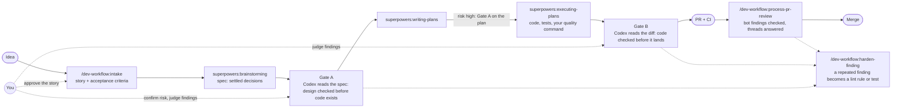

# dev-workflow-kit

A Claude Code plugin, `dev-workflow`, for building software with coding agents. A second
model (Codex) reviews the design before code exists and the diff before it lands.



## Quickstart

You need git, Claude Code 2.1.212 or newer, Node with `npx`, and the Codex CLI logged
in ([`docs/setup.md`](docs/setup.md)).

**1. Install superpowers.**
Do:
```sh
claude plugin marketplace add obra/superpowers-marketplace
claude plugin install superpowers@superpowers-marketplace
```
You see: no error.

**2. Install this plugin.**
Do:
```sh
claude plugin marketplace add dsnger/dev-workflow-kit
claude plugin install dev-workflow@dev-workflow-kit
```
You see: a new Claude Code session offers `/dev-workflow:workflow-init`.

**3. Keep review calls in the foreground.**
Do: in the shell you start Claude Code from, `export CLAUDE_CODE_MCP_AUTO_BACKGROUND_MS=0`, then restart Claude Code.
You see: `echo $CLAUDE_CODE_MCP_AUTO_BACKGROUND_MS` prints `0`.

**4. Set up your project.**
Do: in Claude Code at the project root, type `/dev-workflow:workflow-init`. When it asks to set up Codex now, say "not now".
You see: a status block, one line per written file, an interview for `AGENTS.md`, and a closing checklist.

**5. Connect Codex.**
Do: delete `.context/codex-gate.off`, remove the `INACTIVE` line from `CLAUDE.md` §5, restart Claude Code, approve the project's MCP servers, run `/dev-workflow:workflow-init` again.
You see: `codex MCP ok (pinned mcp-codex-dev@<version>)` in its status block.

**6. Wire your quality command.**
Do: the checks you already run (typecheck, lint, tests, ...) in one command; put it in `AGENTS.md` `## Commands` and `.github/workflows/quality.yml` ([setup step 6](docs/setup.md#6-wire-your-quality-command)).
You see: the command exits 0.

**7. Start the first feature.**
Do: `/dev-workflow:intake <your idea>`.
You see: a story draft with acceptance criteria and a risk proposal. Approve it, say "proceed"; Claude starts the spec.

## What do I type when...

| Situation | Type | Details |
|---|---|---|
| New feature | `/dev-workflow:intake <idea or transcript>` | [guide](docs/getting-started.md#new-feature) |
| Bug or small fix | `/dev-workflow:ticket <text or evidence>` | [guide](docs/getting-started.md#bug-or-small-fix) |
| PR bot comments | `/dev-workflow:process-pr-review <pr-number>` | [guide](docs/getting-started.md#pr-bot-comments) |
| Recurring finding | `/dev-workflow:harden-finding` | [guide](docs/getting-started.md#a-finding-that-keeps-coming-back) |
| Discuss an idea | `/dev-workflow:sparring <question>`, in a new chat | [guide](docs/getting-started.md#discuss-an-idea-first) |
| Update the plugin | `claude plugin marketplace update dev-workflow-kit`, then `claude plugin update dev-workflow@dev-workflow-kit` | [setup step 10](docs/setup.md#10-update-the-plugin-later) |

More: [why](docs/coding-workflow.md), [reference](docs/reference.md) (every skill and
option), [layout](docs/ARCHITECTURE.md).

## Contributing

CI runs the battery in [`AGENTS.md`](AGENTS.md) § Commands. Prompts are reviewed
against [`docs/prompt-standards.md`](docs/prompt-standards.md). Details:
[reference](docs/reference.md#contributing).
