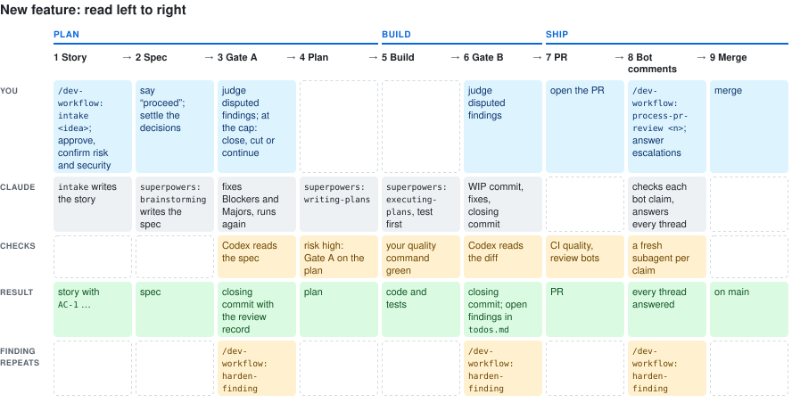

# dev-workflow-kit

A Claude Code plugin, `dev-workflow`, for building software with coding agents. A second
model (Codex) reviews the design before code exists and the diff before it lands.



## Quickstart

You need git, Claude Code 2.1.212 or newer, Node with `npx`, and the Codex CLI logged
in ([`docs/setup.md`](docs/setup.md)).

**1. Install superpowers.**

Do:
```sh
claude plugin marketplace add obra/superpowers-marketplace
claude plugin install superpowers@superpowers-marketplace
```

You see: no error.

**2. Install this plugin.**

Do:
```sh
claude plugin marketplace add dsnger/dev-workflow-kit
claude plugin install dev-workflow@dev-workflow-kit
```

You see: a new Claude Code session offers `/dev-workflow:workflow-init`.

**3. Keep review calls in the foreground.**

Do: in the shell you start Claude Code from, `export CLAUDE_CODE_MCP_AUTO_BACKGROUND_MS=0`, then restart Claude Code.

You see: `echo $CLAUDE_CODE_MCP_AUTO_BACKGROUND_MS` prints `0`.

**4. Set up your project.**

Do: in Claude Code at the project root, type `/dev-workflow:workflow-init`. When it asks to set up Codex now, say "not now".

You see: a status block, one line per written file, an interview for `AGENTS.md`, and a closing checklist. It also asks whether the project takes living docs (documents that stay current with every change, [reference](docs/reference.md#workflow-init)); yes is recommended. With yes, it also asks which folders hold only old dated records (reports, replays, archives; not a folder that also holds current specs), so its link check skips them.

**5. Connect Codex.**

Do: delete `.context/codex-gate.off`, remove the `INACTIVE` line from `CLAUDE.md` §5, restart Claude Code, approve the project's MCP servers, run `/dev-workflow:workflow-init` again.

You see: `codex MCP ok (pinned mcp-codex-dev@<version>)` in its status block.

**6. Wire your quality command.**

Do: the checks you already run (typecheck, lint, tests, ...) in one command; put it in `AGENTS.md` `## Commands` and `.github/workflows/quality.yml` ([setup step 6](docs/setup.md#6-wire-your-quality-command)).

You see: the command exits 0.

**7. Start the first feature.**

Do: `/dev-workflow:intake <your idea>`.

You see: a story draft with acceptance criteria, a risk proposal and `Checkpoints: none`. Confirm it; by default Claude then runs spec, gates, build, PR review and merge without stopping. For critical work, set `Checkpoints: spec, plan, merge` (any subset) to approve those steps yourself.

## What do I type when...

| Situation | Type | Details |
|---|---|---|
| New feature | `/dev-workflow:intake <idea or transcript>` | [guide](docs/getting-started.md#new-feature) |
| Bug or small fix | `/dev-workflow:ticket <text or evidence>` | [guide](docs/getting-started.md#bug-or-small-fix) |
| PR bot comments | `/dev-workflow:process-pr-review <pr-number>` | [guide](docs/getting-started.md#pr-bot-comments) |
| Run Greptile on some PRs only (off by default) | On request: `autoReview: []` in Greptile, `once per PR` in `docs/pr-review-bots.md`, comment `@greptileai`. Or by label: `only with label greptile, once per PR`, its label filter in Greptile, label the PR | [reference](docs/reference.md#pr-review-bots) |
| Actions cannot run the required check | `/dev-workflow:workflow-init` offers `scripts/local-ci.sh` (2.22); disable the workflow, then `sh scripts/local-ci.sh <sha>` per head. Ruleset changes stay yours | [reference](docs/reference.md#contributing) |
| A session says the kit files are older | Run `/dev-workflow:workflow-init` to refresh them (it records the kit version in `.claude/dev-workflow-version`) | [reference](docs/reference.md#hook-messages) |
| Recurring finding | `/dev-workflow:harden-finding` | [guide](docs/getting-started.md#a-finding-that-keeps-coming-back) |
| Discuss an idea | `/dev-workflow:sparring <question>`, in a new chat | [guide](docs/getting-started.md#discuss-an-idea-first) |
| Gate A says "not counted" | Name the pass file in the Codex prompt as `Findings file: <path>` and let Codex write it; a reply alone is no pass | [reference](docs/reference.md#hook-messages) |
| Reviews should run longer, or as before 0.46 | Put `strict` or `classic` into `.claude/codex-gate.mode` (default `lean`; no file means `classic`) and commit it | [reference](docs/reference.md#gate-modes) |
| Old worktrees pile up | `sh scripts/worktree-cleanup.sh <repo>` from a kit checkout; `--remove` deletes only merged, clean worktrees without a live session. Run it yourself or from the orchestrator, never from a session inside one of them | [reference](docs/reference.md#reports) |
| Update the plugin | `claude plugin marketplace update dev-workflow-kit`, then `claude plugin update dev-workflow@dev-workflow-kit` | [setup step 10](docs/setup.md#10-update-the-plugin-later) |

More: [why](docs/coding-workflow.md), [reference](docs/reference.md), [layout](docs/ARCHITECTURE.md).

## Contributing

CI runs the battery in [`AGENTS.md`](AGENTS.md) § Commands. When the Actions budget is used
up, or you choose local up front, disable the workflow, then per commit run
`git fetch origin && sh scripts/local-ci.sh` on the Mac: it runs the same battery on that commit
and posts the same required `quality` check. Switch before you push the commit you run locally: a
`quality` check run that Actions already created on a commit stays on it and must pass too. Prompts
are reviewed against [`docs/prompt-standards.md`](docs/prompt-standards.md). Details:
[reference](docs/reference.md#contributing).
