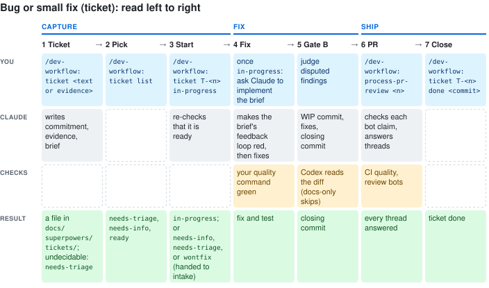

# Getting started: what to type, situation by situation

Setup is done ([`setup.md`](setup.md)). Type a skill or command as
`/dev-workflow:<name>`, or describe the situation and Claude invokes the fitting one. The
skills and gates shape how Claude works. By default a feature runs from intake to merge
without stopping for you: your job is intake's one question round, and the stops that
always apply — a Blocker left at a review's round limit, a change to an approved
commitment, a destructive action outside the branch, missing access or licence. To approve the spec, the plan or the merge yourself, set the
story's `Checkpoints` at intake. Every message the hook prints is a reminder, never a
block. What the gates compare, and what each hook message means:
[`reference.md`](reference.md#the-review-gates).

## New feature

1. Type `/dev-workflow:intake <idea or pasted transcript>` (German is fine).
   You see a story draft: problem, outcome, at least three acceptance criteria numbered
   `AC-1`, `AC-2`, ..., the `AGENTS.md` invariants it touches, and a profile proposal.
   The profile is two levels, how risky and how security-relevant, plus the evidence
   you will owe before the diff review. If the idea is too thin, it asks once and waits.
   It also proposes `Checkpoints: none` — no human stop after this — or, for high-risk
   work on a security guarantee or irreversible data, `spec, plan, merge`.
   You answer: confirm or correct the two levels and the checkpoints. The story lands as
   a committed file under `docs/superpowers/stories/` (with a `spec` checkpoint, after
   you approve the draft).
2. Claude continues with `superpowers:brainstorming`, which writes the spec: settled
   decisions with reasons, not a wish list. Claude answers its questions itself and
   records them under "Decisions" in the spec; the spec's approval is the design approval: its closed Gate A, or, where the gate mode skips Gate A (risk standard, security none), its commit. For a third-party library, Claude looks the
   API up in Context7 for the version you pin and names the lookup; when Context7 is
   unavailable or that version is not indexed, the library's own material for that
   version stands in.
3. Gate A starts (Codex reads the spec text), with the profile from the story. In the
   default mode `lean` it runs only for a spec at risk `high` or with security relevance;
   otherwise the spec says `**Gate A:** skipped` and planning starts at its commit. The mode
   is one word in `.claude/codex-gate.mode` (`lean`, `strict`, or `classic` for the rules
   before 0.46; [reference](reference.md#gate-modes)).
   You see Codex findings in `.context/codex-reviews/gate-a-spec-<nonce>-pass-<n>.md`
   (Claude's verdicts beside it in `…-pass-<n>-dispositions.md`),
   one per line, severity `BLOCKER | MAJOR | MINOR | NIT`. Blockers and Majors get
   fixed and the review runs again. Minors and Nits are collected, not iterated, unless
   they are about security or a broken acceptance criterion.
   In `lean` and `strict`, Gate A is exactly two rounds: a full review, then a round that
   checks the fixes. In `classic` it takes at least three rounds; one with no findings may
   close earlier. From round 2 on, Codex marks each earlier blocking finding `fixed`,
   `not fixed` or `no longer applies`.
   Hook lines like `⚠ Codex Gate A below floor (1/2)` are the round counter, not an
   error. Claude judges disputed findings; a dismissed finding needs a one-line reason.
4. If you see `⚠ Codex Gate A: pass cap reached`, the review hit its round limit. A
   remaining Blocker, security finding or broken acceptance criterion, or a cut to an
   approved commitment, comes to you; you may allow more rounds. Anything else becomes a
   `todos.md` row and the review closes. (In `classic`, Claude may instead delete the
   mechanism the findings keep returning to, cut scope or continue, and records why.)
5. The review ends with one commit that records it (the closing act). Then
   `superpowers:writing-plans` writes the plan: outcomes, affected parts and test
   situations per step, code left to implementation. Gate A runs on the plan only when
   the story's risk is `high`.
6. Subagent-driven development builds it in the same session, test first. Then your quality command from
   `AGENTS.md` must be green; the one exception, a load flake in an untouched test, is in
   the [reference](reference.md#the-review-gates). CI runs the same command later.
7. Gate B starts (Codex reads the diff). Claude commits `WIP: <subject>`, then runs two
   Codex calls per round, `spec` and `quality`, on the same base and head. Same round
   limit and stop as in steps 3 and 4. From round 2 on, Codex marks each earlier
   Blocker and Major `fixed`, `not fixed` or `no longer applies`. With the Ponytail
   plugin installed, `ponytail-review` runs once before the first round.
   When the hook's checks pass, a commit attempt shows a line like `✓ Codex Gate B hook
   checks passed (3/3 cycle, 1 on current fingerprint)`: what the hook counted, not
   permission to close. Other states print other lines
   ([reference](reference.md#the-review-gates)).
8. The closing commit gets a normal subject, the review record lines, and a `todos.md`
   row per finding that was accepted but not repaired. Open the PR and continue at
   "PR bot comments".

## Bug or small fix

For a change that stays inside an approved commitment. A change to the commitment
itself goes through `intake` instead.

1. Type `/dev-workflow:ticket <text or path to evidence>`.
   You see a ticket under `docs/superpowers/tickets/` with the commitment it stays
   inside, the evidence, and the brief a coding agent fixes from. A report nobody can
   decide yet lands as `needs-triage`.
2. Type `/dev-workflow:ticket list`.
   You see the `needs-triage`, `needs-info` and `ready` tickets. Only a `ready` ticket
   carries the hand-off for the fix.
3. Type `/dev-workflow:ticket T-<n> in-progress`. It re-checks that the ticket is
   ready and moves it, or sends it back to `needs-info` or `needs-triage`. It does not
   start the fix: ask Claude to implement the brief. Claude first makes the brief's
   feedback loop red, then fixes, then runs your quality command, then Gate B and the
   PR as in "New feature" steps 7 and 8. A fix whose paths are all explanatory Markdown
   under `docs/`, or `README.md`, `MANIFEST.md`, `todos.md`, skips Gate B; `CLAUDE.md`,
   `AGENTS.md` and anything under `.claude/`, `plugins/`, `skills/` or `commands/` are
   prompts and never do.
4. After the closing commit, type `/dev-workflow:ticket T-<n> done <fix commit>`.

## PR bot comments

1. Open the PR. Wait for the bots listed under "wait for" in `docs/pr-review-bots.md`.
2. Type `/dev-workflow:process-pr-review <pr-number>`.
   You see: CI checked first; each bot claim validated against the code, usually by a
   fresh-context `finding-triage` subagent (on a PR that edits instruction files Claude
   checks them itself and says so); a reply on every thread; accepted regressions fixed
   (substantial ones through Gate B again); valid but out-of-scope findings recorded in
   `todos.md`; and a bot named when it left no review on the current head.
3. You answer: every `escalate-to-user` verdict, and every accepted finding that
   contradicts a settled decision.
4. It squash-merges the PR itself once CI is green, every claim has a reply and the PR
   is mergeable; a bot that left no review is named, not waited for. With `merge` in the
   story's checkpoints it stops at "ready to merge" and you merge. The condition is
   Step 4 of the [command file](../plugins/dev-workflow/commands/process-pr-review.md).

## A finding that keeps coming back

1. Type `/dev-workflow:harden-finding` with the finding, its source (`gate-a`,
   `gate-b`, `bot` or `manual`) and its severity.
   You see: it greps `docs/hardening-log.md` for an earlier occurrence of the same
   class, proposes a lint rule (rung 2) or a test (rung 4), asks when both fit, applies
   it, verifies with your quality command, and logs one row. The cases where it writes
   no row are in the [skill file](../plugins/dev-workflow/skills/harden-finding/SKILL.md).
2. Run it once per `hardening owed` line of a closing commit, as its own change.

## Discuss an idea first

1. In a new chat, type `/dev-workflow:sparring <question>`.
   You see: a read-only investigation, options weighed, an agent's report checked
   against the files, and a bounded prompt for a coding agent.
2. Carry that prompt to the session that does the work. Sparring implements nothing
   and runs no gate.

## The rhythm

Minutes of questions and approval (New feature 1 and 2), a review loop where you mostly
arbitrate (3 to 5), hands-off implementation (6), one more loop (7 and 8), then the PR
close-out. Pausing or leaving the workflow: [`reference.md`](reference.md#opting-out).
