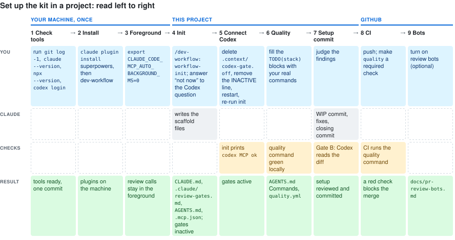
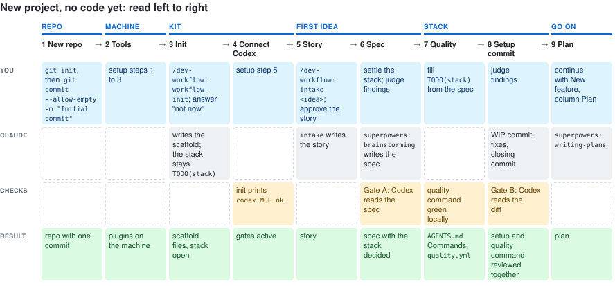

# Setup, step by step

From nothing to a project that runs the workflow. Each step says what to do, what you
should see, and what to do if not. The short version is the README Quickstart. Every
detail behind a step, and everything optional, is in [`reference.md`](reference.md).

The whole setup at a glance, one column per step:



**No code yet?** Start with `git init` and one empty commit (step 1), then do steps 2 to 5.
Leave steps 6 and 7 for later: there is no stack yet to write a quality command for. Your
first `/dev-workflow:intake` and its spec decide the stack. Once the spec is approved (its Gate A closed, or committed when the gate mode skips Gate A;
with checkpoint `spec`, your approval), do
step 6, then step 7 for the setup and the quality command together. The story commit in
between stages only the story file, so the setup files wait for step 7.



## 1. Check what you need

Do: in your project, run `git rev-parse --show-toplevel`, `git log -1 --oneline`,
`claude --version` and `npx --version`. Install the Codex CLI (https://github.com/openai/codex) and run
`codex login` with your OpenAI account. Have a GitHub repository for the project; steps
8 and 9 need it.

You see: a path, one commit line, a Claude Code version of 2.1.212 or higher, an npx
version, and `codex login status` says you are logged in (for example `Logged in using
ChatGPT`).

If not: `/dev-workflow:workflow-init` stops without a git repository. A repository with
no commits yet (`git log` says `does not have any commits yet`) needs one before step 7:
run `git commit --allow-empty -m "Initial commit"`, because Gate B reviews a diff against
the parent of the WIP commit. Step 3 needs that
Claude Code version. The `codex` and `context7` (library docs) MCP server entries are
written for you in step 4 and start through `npx`; for Codex you only need the CLI logged
in, for Context7 nothing. Optional:
`gh` for `/dev-workflow:process-pr-review`, Python 3 for `/dev-workflow:claude-init`.
Why each tool: [reference, Prerequisites](reference.md#prerequisites).

## 2. Install superpowers, then the plugin

Do:

```sh
claude plugin marketplace add obra/superpowers-marketplace
claude plugin install superpowers@superpowers-marketplace

claude plugin marketplace add dsnger/dev-workflow-kit
claude plugin install dev-workflow@dev-workflow-kit
```

You see: a new Claude Code session offers `/dev-workflow:workflow-init` as a command.

If not: restart Claude Code. The plugin's hook is installed once per machine; step 4
turns the workflow on per project.

## 3. Keep review calls in the foreground

Do: in the shell you start Claude Code from, run
`export CLAUDE_CODE_MCP_AUTO_BACKGROUND_MS=0`. Put that line in your shell profile.
Restart Claude Code.

You see: `echo $CLAUDE_CODE_MCP_AUTO_BACKGROUND_MS` prints `0` in that shell.

If not: Claude Code reads the variable at start, so setting it inside a running session
changes nothing. Why it matters: Claude Code moves a long tool call to the background
after 120 seconds, and a review call moved that way never reports its result to the hook.
A positive value works too, if it is longer than your longest review call. Details:
[reference, Background calls](reference.md#background-calls).

## 4. Run /dev-workflow:workflow-init

Do: open Claude Code at the project root and type `/dev-workflow:workflow-init`. In a
project with no `codex` entry in `.mcp.json` yet (the normal first run) the status block
shows Codex as `MISSING`, because this command writes that entry itself, and it asks
whether to set Codex up now. Answer "not now". It also asks whether the project takes living
docs (rules for project documents that stay current with each change; recommended yes).
Answer its other questions. It writes
`AGENTS.md` only after you approve the whole text.

You see, in order: a status block (git repository, superpowers, Codex, `gh`, `AGENTS.md`,
stack); one line per file, `written`, `unchanged`, `merged` or `skipped`; the `AGENTS.md`
interview; a closing checklist whose top item says the gates are `INACTIVE`, with a
`~/.codex/config.toml` block. The files include `.context/codex-gate.on`, which makes the
hook speak in this project. "Not now" also wrote `.context/codex-gate.off`, which keeps
the hook quiet for now, and an `INACTIVE` notice at the top of `CLAUDE.md` §5. Step 5
undoes both.

If not: a missing git repository stops it. An existing `codex` entry shows `NOT LOADED`
with the cause, and the same question; `ok` means Codex already works, and it does not
ask. "Yes" to the question stops the run before any file is written; use it only when an
existing entry needs fixing.
A file that already exists and differs is shown as a diff, and you choose overwrite,
merge or skip. What it writes, and why:
[reference, workflow-init](reference.md#workflow-init).

## 5. Connect Codex

Do: delete `.context/codex-gate.off` and remove the `INACTIVE` notice from `CLAUDE.md`
§5. Restart Claude Code and approve the project's MCP servers (`codex`, `context7`) when
asked. Run `/dev-workflow:workflow-init` again; you can end the run after its status
block.

You see: the status block shows `codex MCP ok (pinned mcp-codex-dev@<version>)`.

If not: the status block shows `NOT LOADED` with the cause and the fix. Which server
works and which does not: [reference, Codex](reference.md#codex). The printed
`~/.codex/config.toml` block is optional: an example shape with placeholders that gives
the Codex reviewer your own MCP servers (database, docs). Adapt it, with real names and
pinned commands, only if Codex should reach such a server.

## 6. Wire your quality command

Do: pick a tool for each role (typecheck, lint, dead code, duplication, tests). Start
with the tools you already run; fill a role later, once a tool has caught something real
for you. Chain them into one command and run it. Put it in `AGENTS.md` under
`## Commands` in the `quality` row, and in the quality-command `TODO(stack)` block of
`.github/workflows/quality.yml`; fill the other `TODO(stack)` blocks there (toolchain
setup, build if any). With living docs taken, add `sh scripts/check-doc-links.sh` to it. Delete the workflow's "Refuse to be a green no-op" step: it fails
while the file contains the text `TODO(stack)`, and its own line does.

Give the agent the access it needs to verify itself. The quality command and the evidence
modes only help when the agent can reach the evidence: let it run the app, read logs and
crash reports, and take screenshots for UI work. A result whose evidence the agent cannot
reach, whether by running the check or by reading its output (a CI log, say), it can only claim. (From Felix Rieseberg, "How to be more ambitious", 2026-10-13.)

You see: the command exits 0 locally.

If not: fix it before step 7. Baselines, if a tool needs one:
[reference, What stays yours](reference.md#what-stays-yours).

## 7. Commit the setup through Gate B

Do: tell Claude to commit everything from steps 4 to 6 as `WIP: adopt dev-workflow`,
run Gate B on that diff per the gate rules, and close the cycle. Gate B means Codex
reads the diff; it is owed here because `CLAUDE.md`, `.claude/` and the workflow files
count as prompts under the rules you just installed. The files include
`.context/codex-gate.on`.

You see: the hook's Gate B lines while the rounds run (`⚠ Codex Gate B below floor
(1/3)` is the round counter), then a closing commit with a normal subject carrying the
cycle records.

If not: the round limit and the stop question are in
[`getting-started.md`](getting-started.md#new-feature), New feature steps 3 and 4. There
is no exemption for this commit; whether a cheaper route should exist is an open point
in the kit's `todos.md`.

## 8. CI and branch protection

Needed before the first PR merges. The first feature (step 11) can start after step 7.

Do: push the branch with the commits from step 7, open a pull request, and watch the
`quality` job. Then, in the repository settings, make `quality` a required check and
turn on "Require branches to be up to date before merging".

You see: the PR shows `quality` as required and green.

If not: open the failing step. The quality step runs the same command as step 6; the
steps before it are CI setup (toolchain, dependencies) and fail for CI-only reasons. Why
"up to date" matters: [reference, CI](reference.md#ci-and-branch-protection).

Hosted Actions is the default; local is the fallback or an up-front choice. No Actions minutes left, or
Actions off? If `/workflow-init` wrote `scripts/local-ci.sh` and `scripts/ci-switch.sh` (it asks),
`sh scripts/ci-switch.sh local "<reason>"` before you push (`sh scripts/ci-switch.sh check <run-id>` tells
whether billing blocked a red run), then run `sh scripts/local-ci.sh <sha>` per head: it runs the
quality command on this machine and posts the `quality` status. A `quality` check restricted to one
app's source, and every ruleset change, are yours to settle first. A branch that requires no check
needs neither: the quality command's result goes into the PR body. Details:
[reference, the local path in a project](reference.md#contributing).

## 9. PR review bots

Optional. Do: if you enabled review bots on the repository (CodeRabbit, Greptile, ...),
open `docs/pr-review-bots.md` (written in step 4) and fill its three lists: wait for,
process opportunistically, ignore. Note where each bot posts. Greptile is off in the kit by
default. To run it on request, set `autoReview: []` in Greptile yourself and comment
`@greptileai` on a PR for one review; for the label path, set `labels: ["greptile"]` and
`autoReview: ["open"]` and label a PR `greptile`. Greptile's own default reviews each PR once when
it opens; per-push review comes only from adding `push` or `rebase` to `autoReview`.

You see: `/dev-workflow:process-pr-review` reads those lists, waits only for the bots
under "wait for", reads the others if they ran, and asks no bot for a review.

If not: with the file missing, the command processes what is visible on the PR and asks
you to fill the file. CodeRabbit note: [reference, PR bots](reference.md#pr-review-bots).

## 10. Update the plugin later

Do:

```sh
claude plugin marketplace update dev-workflow-kit
claude plugin update dev-workflow@dev-workflow-kit
```

Restart Claude Code, then run `/dev-workflow:workflow-init` in each project.

You see: a diff per changed file. Take the ones you want.

If not: `claude plugin update dev-workflow` without the marketplace suffix fails with
"Plugin 'dev-workflow' not found" on CLI 2.1.x. More: [reference, Updates](reference.md#updates).

## 11. First feature

Do: `/dev-workflow:intake <your idea>`.

You see: a story draft with acceptance criteria and a risk proposal (how risky and how
security-relevant the change is). Ask for edits, or say you approve it; on approval it
is committed. Then say "proceed", and Claude starts the spec.
From here: [`getting-started.md`](getting-started.md).

Optional companions (Context7, Ponytail, codebase-memory):
[reference, Optional companions](reference.md#optional-companions).
Hook settings per workspace:
[reference, Per-workspace knobs](reference.md#per-workspace-knobs).
